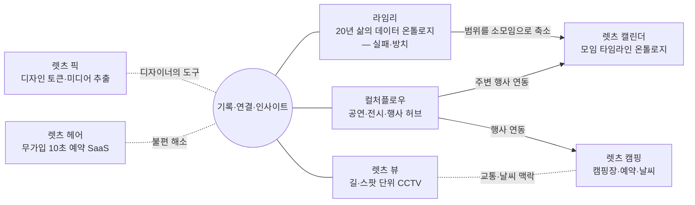

# 인물 분석 — 박영우는 어떤 사람인가

> 출처: `INTERVIEW.md`, `RESUME.md`, 현재 사이트(`data/projects.js`). 사이트 카피·서사의 근거 문서.

## 한 줄 정의
**기록하고, 연결하고, 숫자 속에서 의미를 찾아 — 그것을 직접 쓰는 서비스로 만드는 디자이너.**
"디자이너"보다 **"비즈니스를 디자인하는 사람"** 에 가깝다.

## 핵심 테마
1. **경계를 넘는 융합형** — 1997년 인터넷 첫 경험 이후 디자인 → 마케팅 → 모션/스크립트 코딩 → 공동 창업 → 제품 기획·특허 → 지금은 AI 에이전트와 직접 서비스를 개발·운영.
2. **결과와 숫자로 증명하는 디자인** — 현대홈쇼핑 1억 원 40분 완판, 특허 출원 2건, 명예의전당, 코리아센터 10년 팀장. 디자인 뒤에 늘 성과가 붙는다.
3. **기록 → 연결 → 인사이트** — 20년 가계부·일정 기록 습관. 수치 변화를 파고드는 흥미. 경제·비즈니스·마케팅 정보를 모으고 기억한다.
4. **온톨로지적 사고** — 흩어진 사진·장소·일정·지출·사람을 하나의 축(타임라인)으로 엮는다. 서비스끼리도 서로 연결되게 만든다(컬처플로우 허브).
5. **직접 써보며 끝없이 개선** — 본인이 첫 번째 사용자. 시간이 더 들어도 완성도를 택한다.
6. **무엇을 부각할지가 차별화** — 왜 / 누구에게 / 무엇을 / 어떤 우선순위로. 같은 주제라도 부각점이 명확해야 한다.
7. **실패를 축소해서 다시 해내는 사람** — 라임리(20년치 데이터, 실패) → 렛츠 캘린더(소모임 단위, 성공). 범위를 줄이는 판단력.

## 프로젝트 관계도

> 실선 = 실제 연동/계보(인터뷰 확인). 점선 = 해석상 연결(사이트 표현 시 과장 금지).

## 히어로 카피 (확정)
**흩어진 기록을 / 데이터로 연결하여, / 인사이트를 비지니스로**
(본인 확정 문구 — 표기 '비지니스' 포함 원문 그대로 사용. 이전 후보 5개는 폐기, 서브카피/섹션 타이틀로만 참고 가능)

## 서사 섹션 아웃라인 (1인칭, 담백하게)
1. **1997, 인터넷** — 처음 접한 웹, 웹 컨테스트 수상, 디자인을 시작한 이유.
2. **경계를 넘다** — 공동 창업(캘리세상), 프랜차이즈 마케팅, 영화 모션 광고, 이커머스 10년. 디자인이 비즈니스가 되는 순간들.
3. **숫자로 말하다** — 특허 2건 → 홈쇼핑 40분 완판. 20년 가계부 기록 습관.
4. **기록을 연결하다** — 온톨로지를 알게 되어 라임리가 그렇게 시작되었고, 규모·방대한 데이터 때문에 방치되었고, 그로 인해 렛츠 캘린더가 나올 수 있었다.
5. **작게 다시, 끝까지** — 렛츠 캘린더로 해낸 것, 컬처플로우가 허브가 된 것, 직접 쓰며 고치는 방식.
6. **나의 원칙** — 왜·누구에게·무엇을·우선순위 / 차별화는 무엇을 부각할지에서 시작한다.

## 프로젝트 카드 문안 방향 (의도 / 왜 / 누구에게 어떤 이익)
| 프로젝트 | 의도 | 왜 | 누구에게 어떤 이익 |
|---|---|---|---|
| 렛츠 캘린더 ★ | 모임 하루를 사람·장소·사진·지출로 엮는 타임라인 | 라임리의 꿈을 작은 단위로 실현 | 모임 구성원: 일정 조율, 투명한 정산, 함께 남는 기록 |
| 컬처플로우 ★ | 공연·전시·행사를 한곳에 | 내가 찾아다니기 위해 → 다른 서비스의 허브로 | 문화 생활자 / 내 다른 서비스들 |
| 렛츠 뷰 ★ | 길·스팟 단위로 CCTV를 한 번에 | 지도 앱에서 하나씩 눌러보는 불편 | 운전자·여행자: 교통량·날씨 즉시 확인 (한계: UTIC/NTIC 소스 불안정) |
| 렛츠 캠핑 | 캠핑장을 '다나와처럼' 표준 스펙으로 비교·선택 | 캠핏·땡큐캠핑 등의 수만 개 업장 데이터가 정규화되지 않고 파편화 | 캠퍼: 일일이 매칭할 필요 없이 스펙 비교로 선택 |
| 렛츠 픽 | 원본 이미지·SVG·CSS를 바로 추출 | 원본을 찾으려면 개발자 모드를 열어야 하는 번거로움 → 디자이너용 기능으로 확장, 계속 개선 중 | 디자이너: 레퍼런스 수집·분석 시간 절약 |
| 렛츠 헤어 | 링크 하나로 10초 무가입 예약 | 어머니의 20년 된 구리 동네 미용실: 40~60대 고객은 네이버 예약도 어려워 전화만, 시술·식사 중 전화 응대 부담 | 1인 미용실 원장: 업무 편의 / 고령 고객: 아주 쉬운 예약 |
| 라임리 (출발점) | 20년치 삶의 데이터 온톨로지 | 그렇게 시작되었고, 규모·데이터 방대함으로 방치 | 그로 인해 렛츠 캘린더가 나올 수 있었음 |
> 모든 "왜"는 본인 인터뷰로 확인됨(INTERVIEW.md §7).
